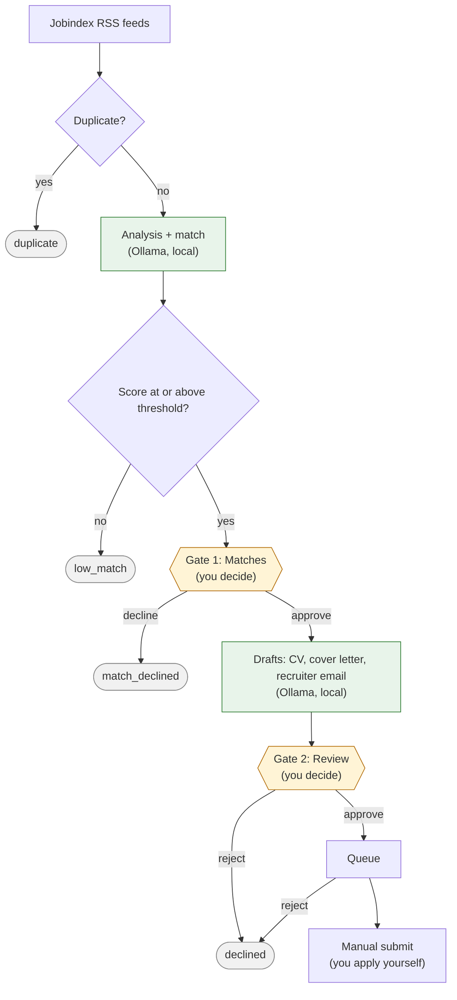

# AI Job Search

A local-only assistant that turns Jobindex job postings into reviewed, ready-to-send applications. It polls Jobindex RSS feeds, deduplicates postings, scores each against your CV, asks you to confirm good matches, and drafts a tailored CV, cover letter and recruiter email in English. Every LLM runs locally through Ollama, and applications are always submitted manually after you review them in the web UI.

## Prerequisites

- Docker Desktop
- Ollama (native Windows install, for GPU access)
- Node 24
- Python 3.12
- [uv](https://docs.astral.sh/uv/)

An `infra/.env.example` is added in plan 03; copy it to `infra/.env` and fill it in before starting the stack.

## Workflow

Two human gates: **Matches** (approve a match) and **Review** (approve the drafts). Green steps run locally on Ollama; nothing is submitted automatically.

PNG copy (used in the recruiter email): `docs/assets/workflow.png`, rendered with `npx -p @mermaid-js/mermaid-cli mmdc -i docs/assets/workflow.mmd -o docs/assets/workflow.png -s 1.6 -b white`.

## Docs

- [Architecture & decisions](docs/architecture.md)
- [Implementation plans](docs/plans/README.md)
- [Original brief](prompts/project-setup.md)
- [Contributor and agent rules](CLAUDE.md)
