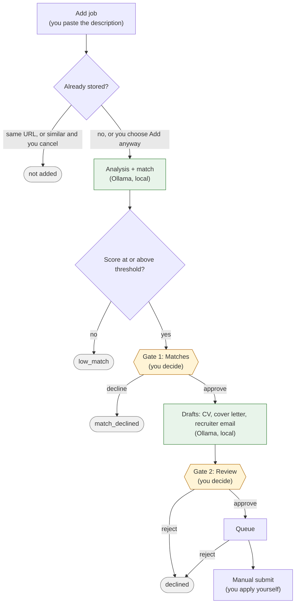

# AI Job Search

A local-only assistant that turns the job postings you pick into reviewed, ready-to-send applications. You paste each job description into the **Add job** form; it deduplicates the posting, scores it against your CV, asks you to confirm good matches, and drafts a tailored CV, cover letter and recruiter email in English. Every LLM runs locally through Ollama, and applications are always submitted manually after you review them in the web UI.

## Prerequisites

- Docker Desktop
- Ollama (native Windows install, for GPU access)
- Node 24
- Python 3.12
- [uv](https://docs.astral.sh/uv/)

## Quick start

PowerShell 5.1 on Windows, from the repo root.

1. Install the prerequisites above and start Ollama. Pull the models: `scripts/pull-models.ps1` (about 9 GB).
2. Copy `infra/.env.example` to `infra/.env`. Replace every `change-me` and set `BACKEND_API_KEY`. `DATA_ROOT` must stay outside OneDrive.
3. Start the stack: `scripts/dev.ps1 up` (starts Docker Desktop if needed, builds the images, waits until healthy).
4. Open LangFlow at http://127.0.0.1:7860, sign in with `LANGFLOW_SUPERUSER`, create an API key (Settings > API Keys) and put it in `infra/.env` as `LANGFLOW_API_KEY`.
5. Import the flows and their variables: `scripts/import-flows.ps1`. Then apply the key: `scripts/dev.ps1 up`.
6. Add your own profile files in `DATA_ROOT\profile\` (never in git): copy the three stubs in `docs/profile-examples/` to `cv.md`, `cover_letter_template.md` and `recruiter_email_template.md`, and edit them.
7. Open http://127.0.0.1:5173, go to **Add job** and paste a job: company, title, application URL (optional) and the whole description. Its analysis starts at once. If the backend restarts during a run, **Process pending** on Home picks up what was left.
8. Work through the tabs: **Matches** (approve or decline), **Review** (read and edit the drafts, approve), **Queue** (copy the email, apply on the employer's site, mark submitted).

Day-to-day operation, backups and upgrades: [docs/operations.md](docs/operations.md).

## Workflow

Two human gates: **Matches** (approve a match) and **Review** (approve the drafts). Green steps run locally on Ollama; nothing is submitted automatically.

PNG copy (used in the recruiter email): `docs/assets/workflow.png`, rendered with `npx -p @mermaid-js/mermaid-cli mmdc -i docs/assets/workflow.mmd -o docs/assets/workflow.png -s 1.6 -b white`.

## Docs

- [Architecture & decisions](docs/architecture.md)
- [Operations: start/stop, backup and restore, upgrades](docs/operations.md)
- [Implementation plans](docs/plans/README.md)
- [Original brief](prompts/project-setup.md)
- [Contributor and agent rules](CLAUDE.md)
